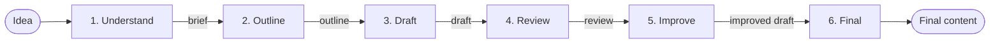

# Multi-Step Content Generator (Ruby on Rails)

The Ruby on Rails version of the Multi-Step Content Generator. It turns a short idea into finished content using **6 separate AI steps** instead of one big prompt.

**Example:** "We launched a new employee attendance feature." → brief → outline → draft → review → improved draft → final announcement.

Built with Ruby on Rails 7.2 and Google Gemini (free tier). The prompts and the 6 steps are the same as in the Python version.

## Screenshots


## How it works



| Step | What it does | Gets | Gives back |
|---|---|---|---|
| 1. Understand | Works out audience, goal, format, tone, key points | idea | brief (JSON) |
| 2. Outline | Plans the title and sections | idea, brief | outline (JSON) |
| 3. Draft | Writes the first draft | idea, brief, outline | draft (text) |
| 4. Review | Gives a score and lists problems with fixes | idea, brief, outline, draft | review (JSON) |
| 5. Improve | Rewrites the draft to fix the problems | idea, brief, draft, review | improved draft (text) |
| 6. Final | Final polish: grammar, title, ending | idea, brief, improved draft | final content (text) |

- The AI doesn't remember earlier calls, so every step is sent what it needs.
- The **original idea** goes to every step, because it's the only source of facts.
- The **brief** goes to every step, so the audience and tone stay the same.
- Unknown details become **[placeholders]** instead of invented facts.

## Files

```
app/services/gemini_client.rb      talks to Gemini (with model fallback and timeout)
app/services/content_pipeline.rb   the 6 steps, the JSON shapes, run and save
app/prompts/                        one prompt per step
app/controllers/contents_controller.rb   the page and the Generate button
app/views/contents/new.html.erb    the page: idea box, final content, every step
app/helpers/application_helper.rb  turns the AI's Markdown into HTML
lib/tasks/test_cases.rake           runs 6 test ideas and saves the results
examples/                           output of every step for each test case
```

## Python version → Rails version

| Python | Rails |
|---|---|
| `pipeline.py` → `ask_ai()` | `GeminiClient.ask_ai` (Gemini's web API via `Net::HTTP`, because Google has no official Ruby library) |
| `pipeline.py` → the 6 step functions | `ContentPipeline.understand`, `.make_outline`, … `.finalize`, `.run` |
| Pydantic classes (`Brief`, `Outline`, `Review`) | Schema hashes (`BRIEF_SCHEMA`, …) and `parse_json` to check the fields |
| `app.py` (Streamlit) | `ContentsController` + `new.html.erb` |
| `test_cases.py` | `bin/rails test_cases` |
| `python-dotenv` | `dotenv-rails` |

## How to run

You need Ruby 3.1+ and a free Gemini API key from https://aistudio.google.com/apikey

```bash
bundle install
cp .env.example .env          # then put your key in .env

bin/rails server              # web page at http://localhost:3000
bin/rails test_cases          # run the test cases

# or run one idea in the terminal
bin/rails runner 'puts ContentPipeline.run("The office is closed on Friday.")[:final]'
```

## Test cases

`bin/rails test_cases` runs 6 ideas through all 6 steps. The output of every step is in the `examples` folder.

| Test case | Idea | Review score of first draft |
|---|---|---|
| [01](examples/01_attendance_feature.md) | We launched a new employee attendance feature. | 10/10 |
| [02](examples/02_vague_idea.md) | AI is changing things. | 6/10 |
| [03](examples/03_technical_topic.md) | Our engineering team moved our main database from MySQL to PostgreSQL. | 9/10 |
| [04](examples/04_short_notice.md) | The office will be closed next Friday for maintenance. | 9/10 |
| [05](examples/05_linkedin_post.md) | LinkedIn post about our team winning the company hackathon. | 8/10 |
| [06](examples/06_idea_with_details.md) | Attendance feature idea with real details (mobile app, weekly report, 1 November) | 8/10 |

## Limitations

- The free Gemini models allow only about 20 requests per day each, and one run uses 6. When one model is used up, the next free model is tried.
- The page waits while the 6 steps run (1–2 minutes). A bigger app would run them in a background job and show live progress.
- The output is a bit different every time.
