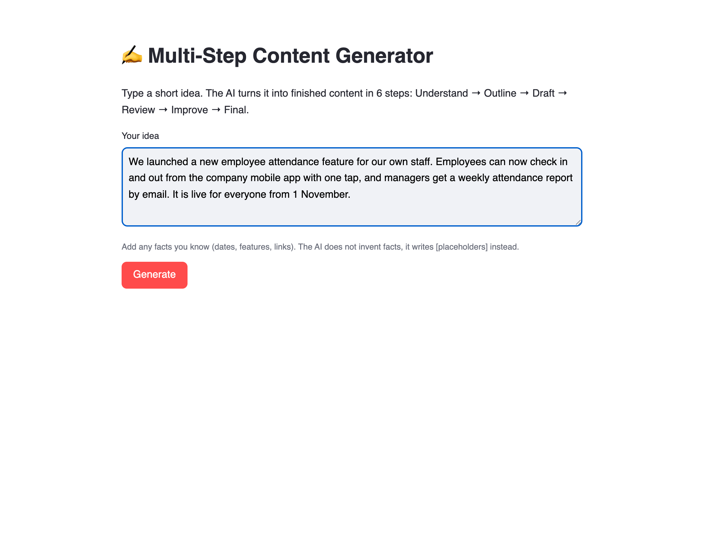
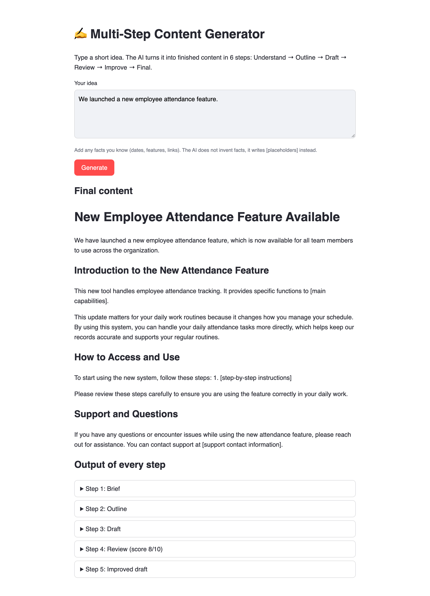

# Multi-Step Content Generator (Ruby on Rails)

This app takes a short idea and turns it into finished content, for example an announcement. Instead of asking the AI once with one big prompt, it goes through 6 separate steps. Each step is its own call to Google Gemini.

Example idea: "We launched a new employee attendance feature."

Live app: https://multi-step-content-generator.onrender.com (the first visit can take about a minute, because the free server sleeps when nobody uses it)

Demo video: https://drive.google.com/file/d/1aJ5pmSSWYeyiUdmxVEViMzOSNStLvoDS/view?usp=sharing

This is the Rails version of my Python project. The prompts and the steps are the same.

## Screenshots





## Problem statement

Often people only have a one-line idea, like "We launched a new employee attendance feature", and need to turn it into a proper announcement, email or post. If you give that idea to an AI in one single prompt, the result usually has these problems:

- It is generic. The AI does not think about who will read it, what the goal is or which tone fits.
- It invents facts. It adds features, dates, names or links that were never in the idea, and they look real.
- Nobody checks it. Mistakes and marketing phrases stay in the text.

The goal of this project is to turn a short idea into content that fits the reader, is ready to use, and does not make things up.

## Solution

The app works like a small writing team. Instead of one prompt, the work is split into 6 steps: understand the idea, plan it, write it, review it, fix it and polish it. Each step is a separate call to Gemini with its own prompt and its own role (content strategist, editor, writer, strict reviewer, final editor).

Main ideas:

- The original idea is the only source of facts. It is sent to every step, and every prompt says not to add facts that are not in it.
- If a detail is missing (like a link or a date), the AI writes a [placeholder] instead of inventing it.
- The brief from step 1 is sent to every later step, so the audience and tone stay the same.
- The review step gives a score and lists every problem with the exact quote and a fix. The improve step then fixes those problems.
- Steps 1, 2 and 4 must answer in JSON with a fixed shape (a JSON schema). The app checks that no field is missing.

## Pipeline

| Step | Role in the prompt | Gets | Gives back |
|---|---|---|---|
| 1. Understand | Content strategist | idea | brief: topic, audience, goal, content type, tone, key points, assumptions (JSON) |
| 2. Outline | Content editor | idea, brief | title and sections, each with heading, purpose and points (JSON) |
| 3. Draft | Writer | idea, brief, outline | first draft (Markdown) |
| 4. Review | Strict editor | idea, brief, outline, draft | score out of 10, strengths, and issues with quote and fix (JSON) |
| 5. Improve | Writer | idea, brief, draft, review | improved draft (Markdown) |
| 6. Final | Final editor | idea, brief, improved draft | final content (Markdown) |

The AI does not remember the earlier calls, so every step is sent everything it needs again.

## Architecture

```
Browser: the user types an idea and clicks Generate
   |
   |  POST /generate
   v
ContentsController (Rails)
   |
   v
ContentPipeline: runs the 6 steps in order
   |  for each step: loads the prompt from app/prompts/
   v
GeminiClient: sends the prompt and the message to the Gemini API
   |  if a model is busy or out of free requests, it tries the next model
   v
Google Gemini API
   |
   v
The results go back to the controller and are shown on the same page:
the final content first, then the output of every step.
Markdown from the AI is turned into HTML with Kramdown.
```

The code is on GitHub. The app runs on Render, which builds it from GitHub and gives it a public URL. The Gemini API key is saved as a setting on Render, not in the code.

## Models, libraries and tools

| What | Used for |
|---|---|
| Google Gemini models: `gemini-3.8-flash`, `gemini-3.6-flash`, `gemini-3.5-flash-lite`, `gemini-3.1-flash-lite` | The AI for all 6 steps. They are tried in this order. If one has used up its free daily limit, has a server error or does not answer in 2 minutes, the next one is used. |
| Gemini API (JSON schema output) | Makes steps 1, 2 and 4 answer in a fixed JSON shape. |
| Ruby 3.1 and Ruby on Rails 7.2 | The web app: routes, controller, page and form protection. |
| Net::HTTP and JSON (built into Ruby) | Calling the Gemini API and reading its answers. There is no official Ruby gem for Gemini. |
| HAML | The page template. |
| Kramdown | Turns the Markdown from the AI into HTML. |
| Rails `sanitize` | Removes unsafe HTML from the AI's output before showing it. |
| dotenv-rails | Loads the API key from the `.env` file when running on my computer. |
| Puma | The web server. |
| Render (free plan) | Hosting. It builds and runs the app and updates it after every push to GitHub. |
| GitHub | Source code. |

## Main files

- `app/services/gemini_client.rb` sends the prompts to Gemini. If a free model has used up its daily limit, it tries the next one.
- `app/services/content_pipeline.rb` has the 6 steps.
- `app/prompts/` has the prompt for each step.
- `app/controllers/contents_controller.rb` shows the page and handles the Generate button.
- `app/views/contents/new.html.haml` is the page.
- `app/helpers/application_helper.rb` turns the Markdown from the AI into HTML.
- `render.yaml` has the settings for Render.

## How to run

You need Ruby 3.1 or newer and a free Gemini API key from https://aistudio.google.com/apikey

```bash
bundle install
cp .env.example .env    # then put your key in .env
bin/rails server
```

Then open http://localhost:3000

## Limitations

- The free Gemini models allow only about 20 requests a day each, and one run uses 6 requests.
- The page has to wait while the 6 steps run, which takes 1-2 minutes.
- On Render's free plan the app goes to sleep when nobody uses it, so the first visit can take about a minute.
- The output is a bit different every time.
